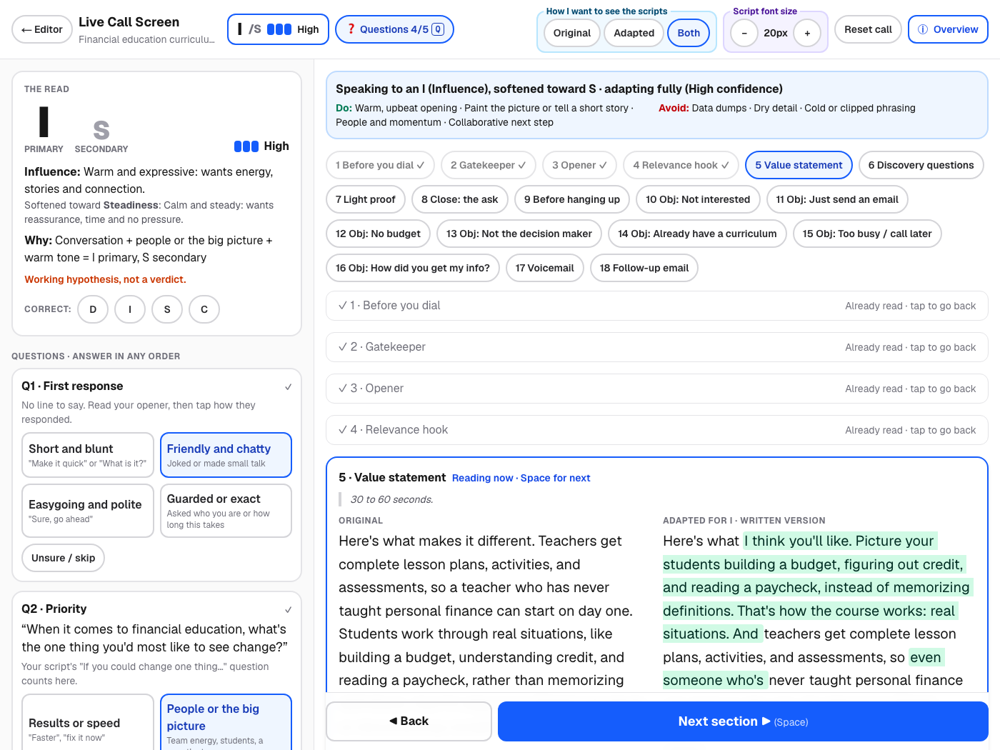
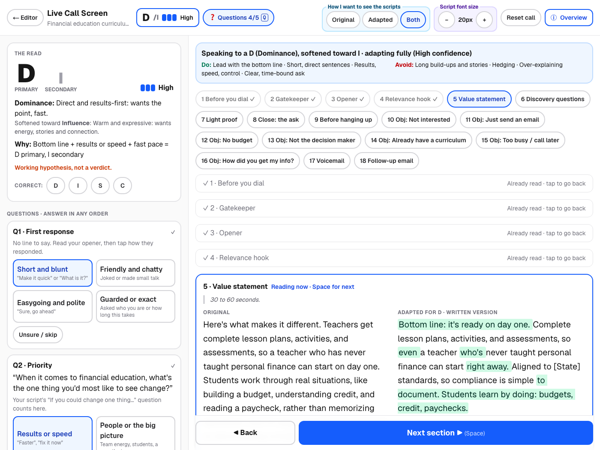
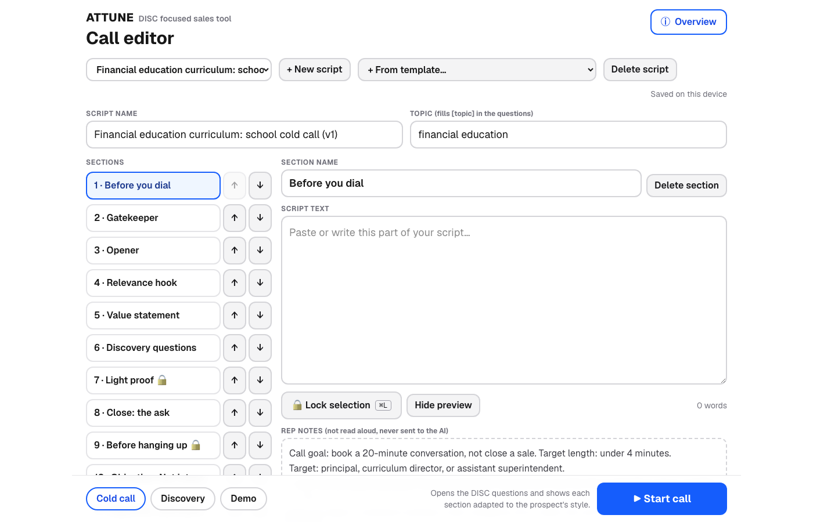

# Attune

**A DISC-focused sales tool: read the room in the first minutes of a call, then speak their language.**

**[Try the live demo →](https://asher40121.github.io/attune-showcase/)** It runs entirely in your browser. No sign-up, and nothing is sent anywhere.

## The problem

Most sales reps use one script for everyone, but people take in information differently. Some want the bottom line in 20 seconds. Others want a conversation, reassurance, or the details. Reps trained in DISC rarely apply it on live calls: reading a style takes attention they don't have, and rewriting a script mid-call is impossible.

## How Attune works

1. **Prepare.** Paste your script into the Call editor in named sections. Lock any legal or compliance wording, and add private rep notes.
2. **Read the prospect.** On the Live Call Screen, tap how the prospect answers a few natural questions, whenever they come up in the call. A transparent scoring rule turns the taps into a read: primary style, secondary style, a confidence level and a one-line "why".
3. **Speak their language.** Each upcoming section of *your own* script appears next to a version adapted for that style. Changes are highlighted, locked text never changes, and nothing new is invented.

| Style | What they want |
|---|---|
| **D** · Dominance | Direct and results-first: the point, fast |
| **I** · Influence | Warm and expressive: energy, stories and connection |
| **S** · Steadiness | Calm and steady: reassurance, time and no pressure |
| **C** · Conscientiousness | Careful and exact: facts, specifics and a clear process |

## Same section, two prospects

The value statement from the built-in school cold call script, adapted for a **High D** (left) and a **High I** (right):

| High D | High I |
|---|---|
|  |  |

- **D** leads with "Bottom line: it's ready on day one," cuts the build-up, and closes with two times and "Your call."
- **I** opens with students building a budget and reading a paycheck, adds a check-in question, and invites a colleague to the next step.

## Features

**Built for a live call**
- Big tap targets, large adjustable script text, one-key navigation (Space for the next section)
- Questions can be answered in any order, at any point in the call, with "Unsure / skip"
- Read sections collapse so the current one stays in view; jump straight to any objection
- Original, Adapted or Both views; an Overview explains the tool in-app

**A read you can trust and override**
- Deterministic, weighted scoring that runs instantly in the browser, not a black box
- Confidence rises with coverage and with how clearly one style leads; opposite styles at the top are flagged as mixed signals
- One-tap correction: the rep's judgment always wins
- The less certain the read, the lighter the adaptation

**Safe adaptation**
- **Locked text:** compliance wording is replaced with placeholders before adaptation and verified word for word afterward, in code
- **No invented facts:** adapted versions can restructure and add connective lines, but never new claims, numbers, names or promises; [bracketed] fill-ins must survive
- **Rep notes** (stage directions, "listen for…") are kept separate and never adapted
- 140 automated tests cover scoring, lock handling, templates and every hand-written style version

**Private by design**
- No accounts. Scripts and call answers are stored only in the rep's browser.

## Responsible use

A read is a **working hypothesis, not a verdict**. DISC is a simplified model of communication preferences. Attune uses it to help reps communicate better, never to label, judge or make decisions about people, and never for hiring. The questions are genuine discovery questions, so prospects never feel profiled, and Attune doesn't scrape social profiles to guess anyone's personality.

## Roadmap

- ✅ Call editor with sections, locked text and rep notes
- ✅ Live Call Screen: questions, transparent scoring, read card, side-by-side adapted script
- ✅ Hand-written D/I/S/C versions of the built-in school cold call script
- ⏳ AI rewrite of any script with Claude, streamed section by section, with the same lock and fact checks
- ⏳ Call types: a quick read for cold calls; discovery and demo emphasis
- ⏳ Fill in [placeholders] once before dialing
- ⏳ Personal stats: time to a confident read, and how often reads were right
- 🔭 Future: a possible Salesforce add-on

## More

- [Product brief](docs/PRODUCT_BRIEF.md): problem, persona, jobs to be done, scope, success metric and design decisions
- [Overview screenshot](assets/screenshots/overview.png)

**Built with:** Next.js, TypeScript, Tailwind CSS and Vitest. The source code is private; this repository is a showcase only.

## Contact

**Phil Albritton**, product leader and creative developer · [GitHub profile](https://github.com/Asher40121)

---

© 2026 Phil Albritton. All rights reserved. See [LICENSE.md](LICENSE.md).
